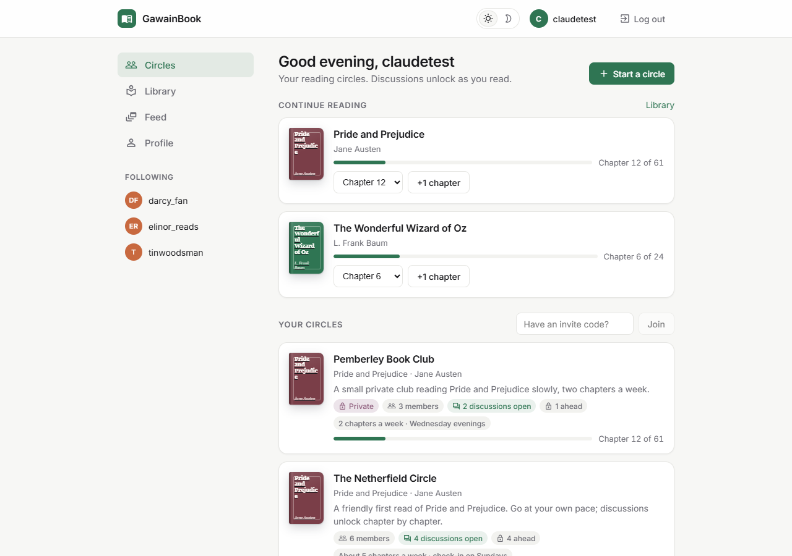
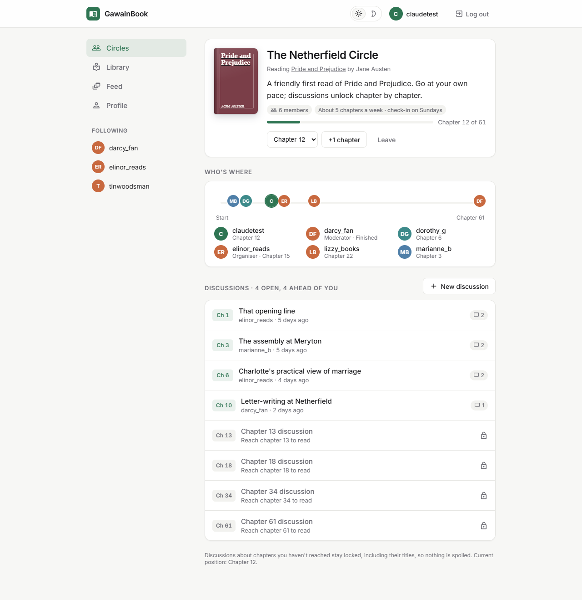
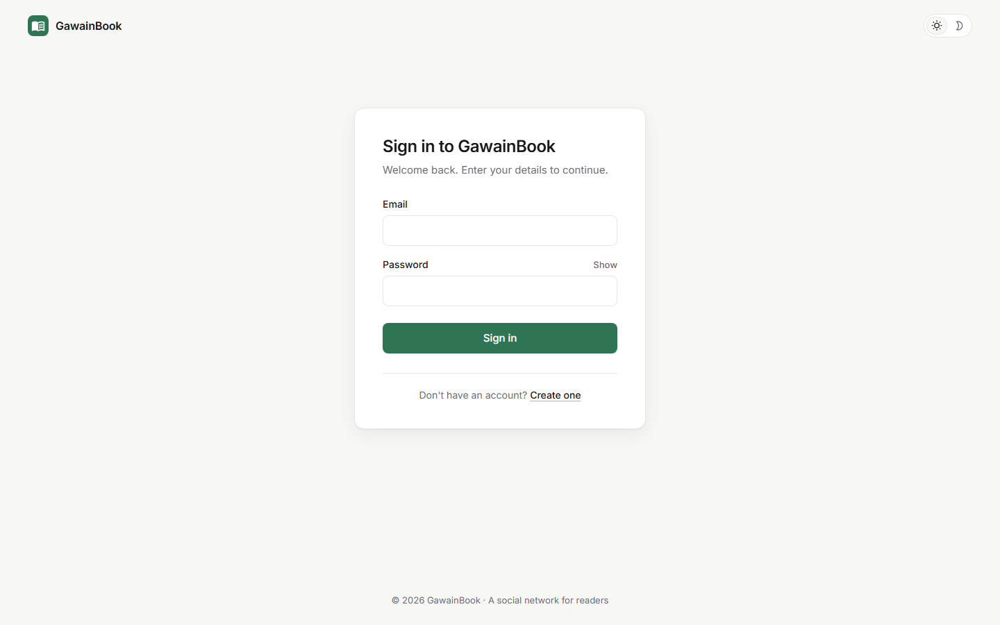
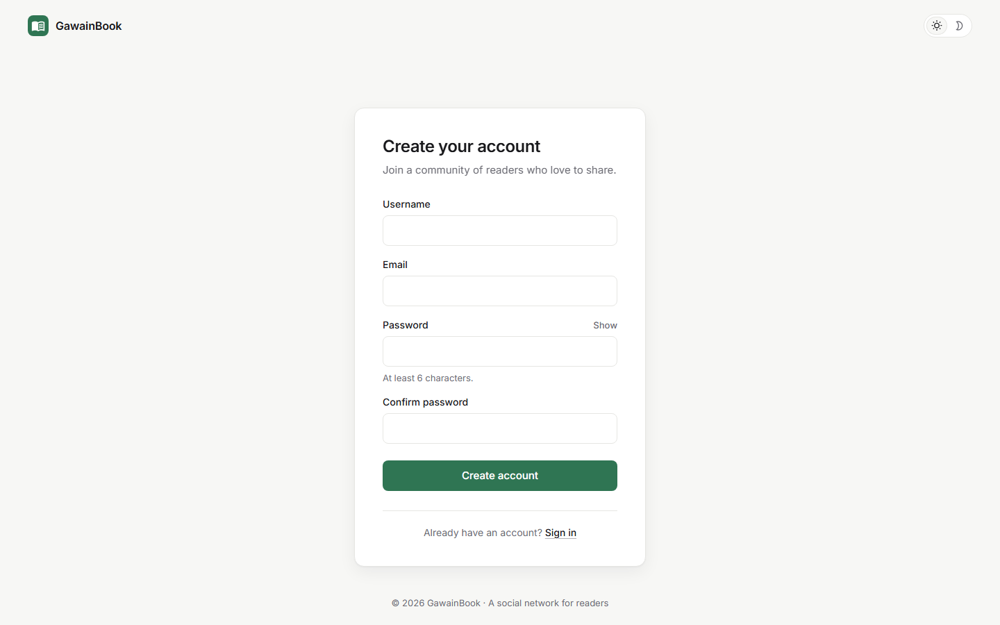

<p align="center">
  
</p>

<p align="center">
  <a href="https://gawainbook.onrender.com"><strong>Live demo</strong></a> ·
  <a href="#getting-started">Run locally</a> ·
  <a href="#api-reference">API</a> ·
  <a href="#roadmap">Roadmap</a> ·
  <a href="docs/decisions/README.md">Decision log</a>
</p>

<p align="center">
  <a href="https://github.com/rafeyshah/GawainBook-SocialMediaApp/actions/workflows/ci.yml"></a>
  
  
  
  
  
  
  
</p>

---

## About

**GawainBook** is a social network for readers. Share what you're reading, post your thoughts and quotes, follow other readers and see what the people you trust are reading next.

It's a full-stack TypeScript/JavaScript app: a React frontend and an Express API backed by **PostgreSQL on Neon**, with photos in **Neon object storage**. It's deployed as a single service: the Express API also serves the React app, so the whole thing runs at one URL.

> **Live demo:** https://gawainbook.onrender.com
> Runs on Render's free plan, which sleeps after 15 minutes without visitors. The first load can take 30–60 seconds while it wakes up.

## Screenshots

| Your circles | A circle: who's where, and spoiler-locked discussions |
| :---: | :---: |
|  |  |
| **Sign in** | **Create account** |
|  |  |

## Features

**Accounts**
- Sign up and sign in from a single page, with a smooth switch between the two
- Clear inline errors (wrong password, email already registered, username taken)
- Secure sessions: an httpOnly cookie (never readable by JavaScript), CSRF protection, server-side logout, and rate limits on sign-in
- Sign-in emails are case- and whitespace-insensitive; password hashes never leave the server
- Log out from the top bar
- Light and dark themes, remembered per browser

**Reading circles (the home screen)**
- Small groups reading the same book at their own pace
- **Spoiler-safe chapter discussions:** a discussion stays locked, with its title and replies hidden, until *you* reach that chapter. The rule lives in one place (`src/policy.ts`) and is applied on every read path
- "Who's where": see where each member is in the book
- Public circles anyone can join, private circles with invite codes, organiser and moderator roles
- Start discussions only about chapters you've reached; reply, and delete your own replies (moderators can delete any)

**Books and library**
- Shelves: *Want to read*, *Reading*, *Finished*, with chapter-by-chapter progress (private to you)
- Book pages with chapters, your progress, and the circles reading them
- Public-domain books to start: *Pride and Prejudice*, *The Wonderful Wizard of Oz*, *Persuasion*

**Social**
- Share posts with text and a photo, with no page reload, a 500-character limit and a live counter near the limit
- Photos are stored in a private Neon bucket and served through short-lived signed links, so they survive redeploys
- A home feed of your posts and posts from people you follow, newest first
- Profile pages with bio, location, join date, and follower and following counts
- Follow and unfollow other readers
- Like and unlike posts; likes update instantly and roll back if the server rejects them
- A sidebar listing the readers you follow
- Loading, empty and error states everywhere, with a retry option

## Roadmap

The full plan is in [`docs/plan/GawainBook_Launch_Plan.md`](docs/plan/GawainBook_Launch_Plan.md), and the reasoning behind each technical choice is in the [decision log](docs/decisions/README.md).

- [x] PostgreSQL on Neon, with migrations ([D1](docs/decisions/0001-database-postgresql.md), [D4](docs/decisions/0004-data-access-drizzle.md))
- [x] Image uploads in object storage ([D8](docs/decisions/0008-hosting.md))
- [x] Real authentication: httpOnly session cookies, CSRF protection and rate limits ([D2](docs/decisions/0002-auth-session-cookies.md))
- [x] Continuous integration: both test suites and the build run on every push
- [x] Waitlist, privacy notice and Impressum (the waitlist opens once the legal details are set)
- [x] Bookshelves: *Want to read*, *Reading*, *Finished*
- [x] Reading circles with chapter progress and spoiler-safe discussions
- [ ] Reporting, blocking and notifications (rest of Phase 1)
- [ ] A spoiler-aware reading assistant for public-domain books
- [ ] Password reset by email

## Tech stack

| Layer | Technology |
| --- | --- |
| Frontend | React 17, React Router 5, Material UI 4 icons, Axios |
| Backend | Node.js 22, Express 4, **TypeScript**, bcrypt, Helmet, Multer |
| Database | **PostgreSQL on Neon**, **Drizzle ORM** + SQL migrations, node-postgres |
| File storage | **Neon object storage** (S3-compatible, private bucket, presigned URLs) |
| Testing | Jest, Supertest, React Testing Library, a real embedded PostgreSQL for backend tests |
| Hosting | Render (single web service, auto-deploys on every push to `master`) |

## Project structure

```
.
├── Node-Rest-API/            Express API in TypeScript (also serves the built React app)
│   ├── src/
│   │   ├── db/               Drizzle schema (users, follows, posts, post_likes) and connection
│   │   ├── routes/           /api/auth, /api/users, /api/posts
│   │   ├── storage.ts        Neon object storage (or local disk as a fallback)
│   │   ├── app.ts            Express app: security headers, uploads, images, routes
│   │   ├── index.ts          Entry point: env, migrations, server
│   │   └── scripts/          One-off MongoDB → Postgres migration
│   ├── drizzle/              SQL migrations (generated by drizzle-kit, committed)
│   ├── public/images/        Bundled default images (avatars, placeholders)
│   └── tests/                API, database, storage and migration tests
├── react-frontend/           React app (Create React App)
├── docs/                     Banner, screenshots, decision log, launch plan
├── neon.ts                   Neon infrastructure as code (Postgres + "assets" bucket)
├── package.json              Root scripts: build, start, test
└── render.yaml               Render deployment blueprint
```

## Getting started

### Prerequisites

- **Node.js 20 or newer.** The frontend's `react-scripts` 4 only runs on Node 16, so the root scripts run it through `npx -p node@16` automatically.
- **A Neon project** with Postgres and object storage. The [Neon CLI](https://neon.com/docs/cli) sets it up for you.

### 1. Clone and install

```bash
git clone https://github.com/rafeyshah/GawainBook-SocialMediaApp.git
cd GawainBook-SocialMediaApp
npm ci && npm run install:all
```

### 2. Connect to Neon

```bash
npm i -g neon@latest
neon login
neon link            # pick your project and branch
neon deploy          # creates the "assets" bucket from neon.ts
```

`neon deploy` writes the connection variables into `.env.local` in the repo root (it's git-ignored). The backend reads it automatically.

| Variable | Description |
| --- | --- |
| `DATABASE_URL` | Pooled Postgres URL, used by the app |
| `DATABASE_URL_UNPOOLED` | Direct Postgres URL, used for migrations |
| `AWS_ACCESS_KEY_ID`, `AWS_SECRET_ACCESS_KEY`, `AWS_ENDPOINT_URL_S3`, `AWS_REGION` | Neon object storage credentials. Without them, uploads are saved to local disk |
| `PORT` | API port. Defaults to `8800` |
| `LEGAL_NAME`, `LEGAL_ADDRESS`, `LEGAL_EMAIL` | Your details for the Impressum and privacy notice. `LEGAL_ADDRESS` lines are separated by `|` |
| `WAITLIST_OPEN` | Set to `true` to accept waitlist sign-ups. Only takes effect once the three legal details are set |

> Tip: use `neon checkout dev --create` to work on your own copy-on-write branch of the database and files instead of production.

### 3. Run it

```bash
npm run build     # builds the React app and the TypeScript API
npm start         # http://localhost:8800 (runs migrations on startup)
```

Check http://localhost:8800/api/health. It should return `{"db":"connected","error":null,"storage":"neon"}`.

For frontend development with live reload, run the API as above, then in a second terminal:

```bash
cd react-frontend
npx -p node@16 node node_modules/react-scripts/bin/react-scripts.js start
```

Open http://localhost:3000. The dev server forwards `/api` requests to the API on port 8800.

### Changing the database schema

Edit `Node-Rest-API/src/db/schema.ts`, then generate a migration and commit it:

```bash
cd Node-Rest-API
npm run db:generate
```

Migrations are applied automatically, over the direct connection, when the server starts.

## API reference

Every endpoint is under `/api`. Request and response bodies are JSON.

**Authentication:** sign-in sets an httpOnly `gb_session` cookie. Every route except health, sign-up, sign-in, legal and waitlist requires it, and the user is **always taken from the session**, never from the request. Every state-changing request must send the `gb_csrf` cookie's value in an `X-CSRF-Token` header.

| Method | Endpoint | Description |
| --- | --- | --- |
| `GET` | `/health` | Database and storage status |
| `POST` | `/auth/register` | Create an account: `{ username, email, password }` |
| `POST` | `/auth/login` | Sign in: `{ email, password }` (sets the session cookie) |
| `POST` | `/auth/logout` | End the session |
| `GET` | `/auth/me` | The signed-in account (401 if signed out) |
| `GET` | `/users?username=` or `/users?userId=` | Get a user |
| `PUT` | `/users/:id` | Update your profile: `desc`, `city`, `from`, `relationship`, `profilePicture`, `coverPicture`, `password` |
| `DELETE` | `/users/:id` | Delete your account (posts, likes and follows go with it) |
| `GET` | `/users/friends/:userId` | List the people a user follows |
| `PUT` | `/users/:id/follow` | Follow a user |
| `PUT` | `/users/:id/unfollow` | Unfollow a user |
| `POST` | `/posts` | Create a post: `{ desc, img? }` |
| `PUT` | `/posts/:id` | Edit your post's text |
| `DELETE` | `/posts/:id` | Delete your post |
| `PUT` | `/posts/:id/like` | Like or unlike a post → `{ liked, likes }` |
| `GET` | `/posts/:id` | Get a post |
| `GET` | `/posts/timeline` | Your feed: your posts plus posts from people you follow |
| `GET` | `/posts/profile/:username` | A user's posts |
| `GET` | `/legal` | Public: Impressum details and whether the waitlist is open |
| `POST` | `/waitlist` | Public: `{ email, favouriteGenre, organizesBookClub, consent: true }` |
| `GET` | `/books`, `/books/:idOrSlug` | Books, with your shelf and progress |
| `PUT` | `/books/:id/progress` | `{ shelf?, chapter? }`: set your shelf and/or chapter |
| `GET` | `/shelves[?username=]` | Shelves (others' shelves never include chapters) |
| `GET` | `/circles` | `{ mine, discover }` |
| `POST` | `/circles` | Start a circle: `{ name, bookId, visibility, schedule?, description? }` |
| `GET` | `/circles/:id` | A circle (404 if private and you're not a member) |
| `POST` | `/circles/:id/join`, `/circles/join`, `/circles/:id/leave` | Join a public circle, join with `{ code }`, leave |
| `GET` / `POST` | `/circles/:id/threads` | Discussions (later chapters come back locked) / start one `{ chapter, title, body? }` |
| `GET` | `/threads/:id` | A discussion and its replies (403 with no content if locked) |
| `POST` | `/threads/:id/comments` | Reply `{ body }` |
| `DELETE` | `/comments/:id` | Delete your reply (moderators: any reply) |
| `POST` | `/upload` | Upload an image (multipart field `file`; PNG, JPG, GIF or WebP, max 5 MB) → `{ filename }` |

Uploaded images are served at `/images/<filename>`, which redirects to a signed, time-limited link in the private bucket.

## Testing

Both halves of the app have automated tests. They cover success paths, validation, missing and invalid data, permissions, concurrency, database constraints, failure handling and the security fixes.

```bash
npm test                  # everything
npm run test:backend      # API + database tests
npm run test:frontend     # React tests
```

- **Backend:** Jest and Supertest against a **real, throwaway PostgreSQL server** (embedded-postgres), with the real migrations applied, so constraints and cascades are tested exactly as they run in production. Object storage is tested with a fake S3 client. Nothing touches Neon.
- **Frontend:** Jest and React Testing Library.

## Deployment

The app deploys to [Render](https://render.com) using [`render.yaml`](render.yaml). Every push to `master` rebuilds the React app and the API and redeploys them together; migrations run when the new server starts.

**One-time setup**
1. In Render, choose **New → Blueprint** and select this repository.
2. When prompted, paste the values from your `.env.local`: `DATABASE_URL`, `DATABASE_URL_UNPOOLED`, `AWS_ACCESS_KEY_ID`, `AWS_SECRET_ACCESS_KEY` and `AWS_ENDPOINT_URL_S3`.
3. After the deploy, open `/api/health` and check for `"db":"connected"` and `"storage":"neon"`.

**Demo data (optional)**

```bash
cd Node-Rest-API
npm run seed:demo -- --member=<your-username>   # sample readers, circles and discussions
npm run seed:demo -- --remove                   # delete all of it
```

Sample accounts are clearly labelled ("Sample reader · demo account") and use the reserved `sample.gawainbook.invalid` email domain. The command prints their password. It's safe to run more than once, and `--remove` keeps real accounts.

**Moving data from the old MongoDB database (once)**

```bash
# add MONGO_URL to Node-Rest-API/.env, then:
cd Node-Rest-API
npm run migrate:mongo -- --dry-run   # shows what would move
npm run migrate:mongo                # copies users, follows, posts, likes and images
```

It keeps user ids and password hashes, so existing accounts keep working, and it's safe to run more than once.

**Known limitations on the free plan**
- The web service sleeps when idle, so the first request afterwards is slow.
- Neon's free compute suspends when idle; the first query after that takes a little longer.

## Product discovery

Interview script, recruiting posts and notes template: [`docs/discovery/`](docs/discovery/README.md).

## Contributing

Contributions are welcome.

1. Fork the repo and create a branch: `git checkout -b feature/my-change`
2. Commit your changes with a clear message.
3. Open a pull request describing what changed and why.

For larger changes, please open an issue first to discuss the approach.

## License

Released under the [MIT License](https://choosealicense.com/licenses/mit/).
