<p align="center">
  
</p>

<p align="center">
  <a href="https://gawainbook.onrender.com"><strong>Live demo</strong></a> ·
  <a href="#how-the-spoiler-lock-works">How it works</a> ·
  <a href="#screenshots">Screenshots</a> ·
  <a href="#getting-started">Run locally</a> ·
  <a href="#api-reference">API</a> ·
  <a href="#roadmap">Roadmap</a> ·
  <a href="docs/decisions/README.md">Decision log</a>
</p>

<p align="center">
  <a href="https://github.com/rafeyshah/GawainBook-SocialMediaApp/actions/workflows/ci.yml"></a>
  
  
  
  
  
  
  
</p>

---

## About

**GawainBook** is a home for reading circles: small groups reading the same book at their own pace. Every discussion belongs to a chapter, and **a discussion stays locked until you reach that chapter**: its title, its replies, search results and notifications included. So the reader on chapter 4 can talk freely with the reader on chapter 40, and neither spoils anything for the other.

Around that sit the things a reading community needs: shelves and chapter-by-chapter progress, invite links for private circles, organiser and moderator roles, reporting and blocking, and a feed for sharing what you're reading.

It's a full-stack TypeScript app: a React frontend and an Express API backed by **PostgreSQL on Neon**, with photos in **Neon object storage**. It runs as a single service: the Express API also serves the React app, so the whole thing lives at one URL.

> **Live demo:** https://gawainbook.onrender.com
> Runs on Render's free plan, which sleeps after 15 minutes without visitors. The first load can take 30–60 seconds while it wakes up.

## How the spoiler lock works

One function decides who can see what ([`src/policy.ts`](Node-Rest-API/src/policy.ts)), and every route that returns discussion content goes through it. Lists apply the same rule in SQL (`chapter <= your progress`), so later chapters never leave the database.

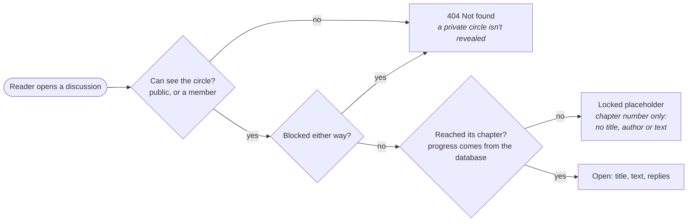

The same check filters thread lists, single threads, replies, search and notifications. Move your progress back and later discussions lock again straight away. A [10-case test matrix](docs/plan/GawainBook_Launch_Plan.md#44-the-test-matrix-that-proves-the-core-promise) and a Playwright test in a real browser prove it.

## Screenshots

<p align="center">
  
  <br><sub><b>A reading circle.</b> Who's where in the book, discussions up to your chapter, later ones locked. Organisers get invite links, members and reports beside it.</sub>
</p>

| Your circles | Notifications, filtered by the spoiler rule |
| :---: | :---: |
|  | 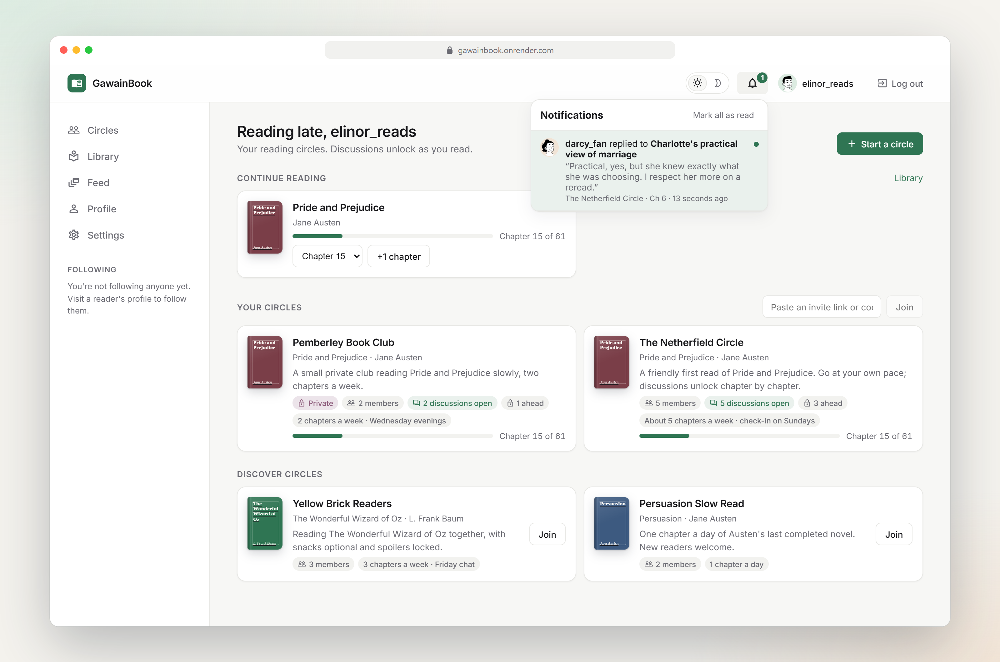 |
| **A chapter discussion** | **Book page with chapter map** |
| 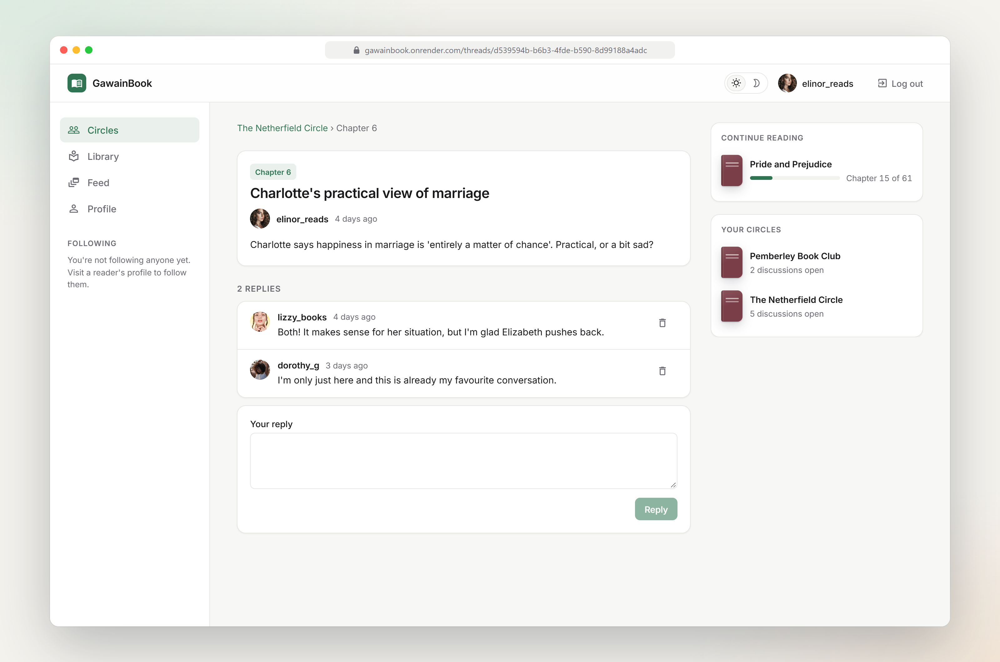 | 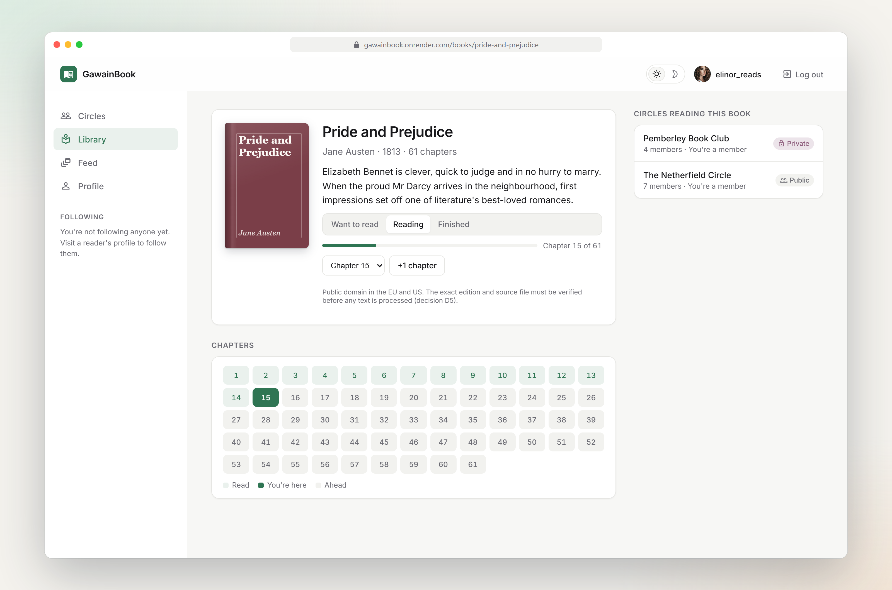 |
| **Profile and reading profile** | **Library: shelves and book search** |
| 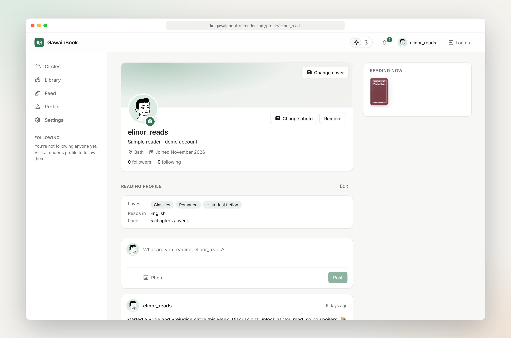 | 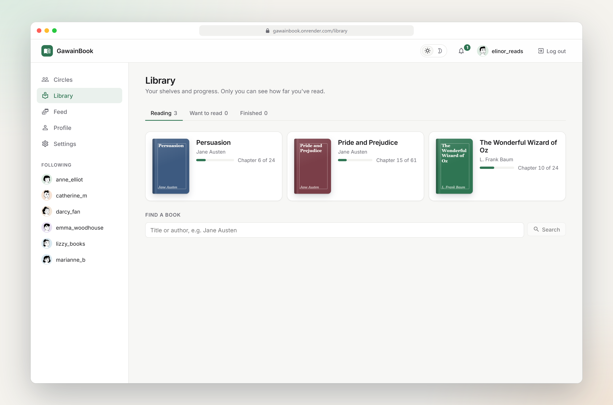 |
| **Settings: password, data export, deletion** | **Dark mode** |
| 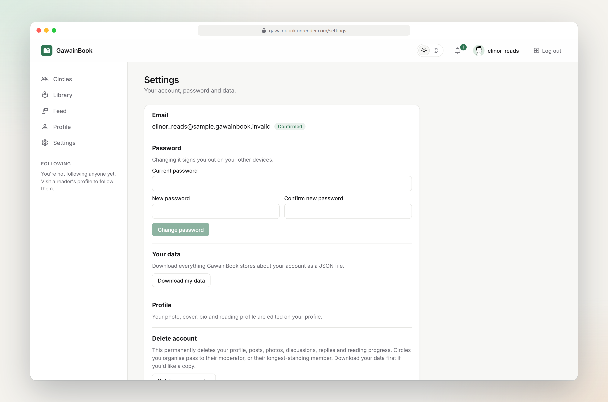 | 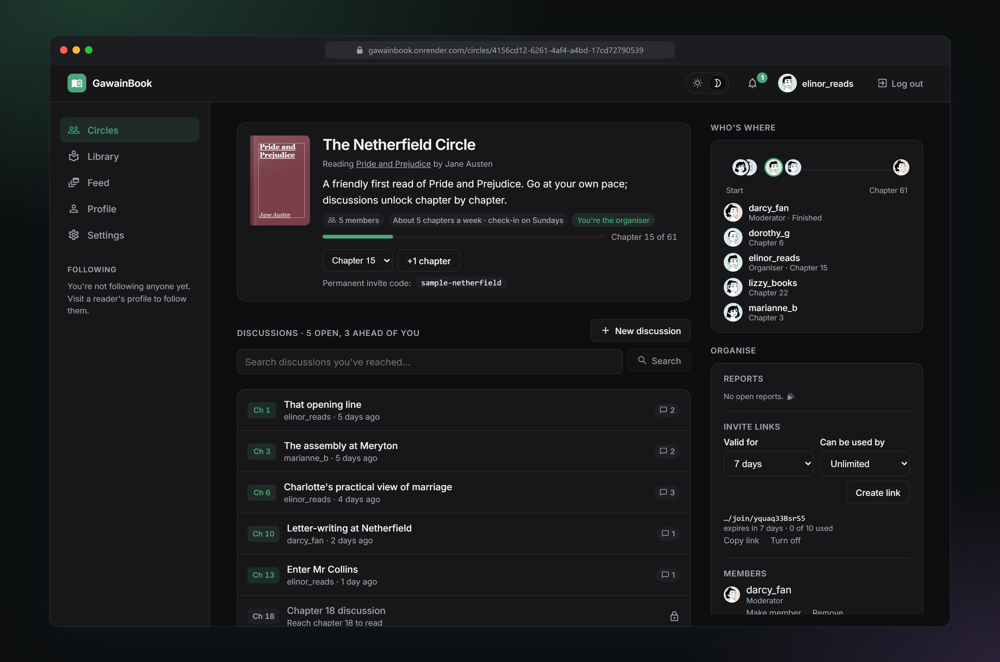 |
| **Sign-up with consent** | **On your phone** |
| 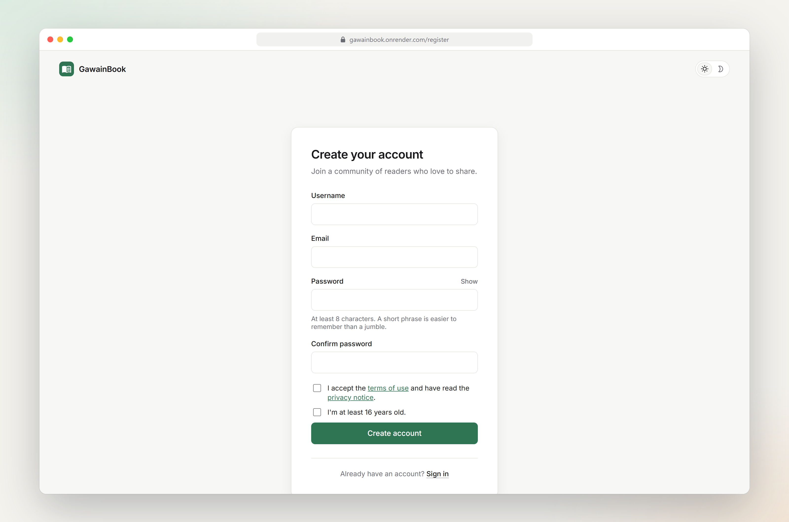 | 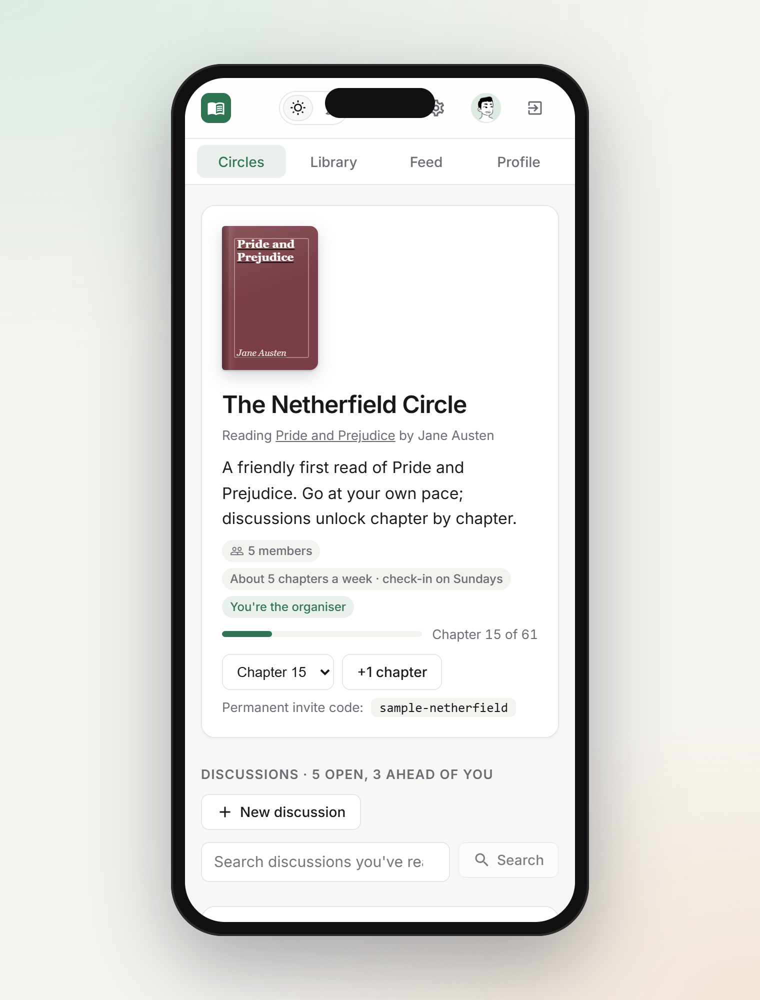 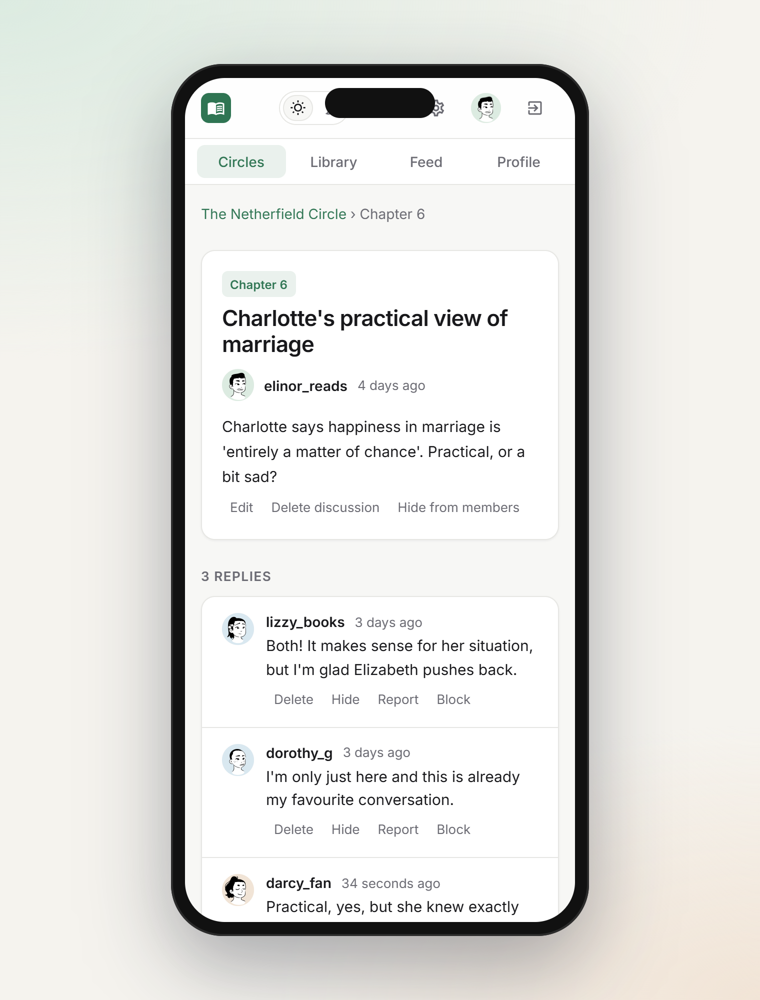 |

<sub>Captured from a throwaway copy of the app with the demo data (sample readers use CC0 avatars). Regenerate them with [`e2e/scripts/readme-screenshots.js`](e2e/scripts/readme-screenshots.js).</sub>

## Features

**Accounts**
- Sign up and sign in from a single page, with a smooth switch between the two and clear inline errors
- Sign-up asks you to accept the terms and privacy notice and to confirm you're at least 16; the accepted terms version is recorded
- Confirm your email from a link; a banner reminds you until you do
- **Forgotten password:** reset by email with a single-use link that lasts one hour. The answer is the same whether or not an account exists, so nobody can find out who's signed up
- **Settings:** change your password (needs the current one, signs out other devices), download all your data as JSON, delete your account
- Secure sessions: an httpOnly cookie (never readable by JavaScript), CSRF protection, server-side logout, and rate limits on sign-in and password reset
- Passwords of at least 8 characters, stored only as bcrypt hashes
- Light and dark themes, remembered per browser
- Full-width layout with a fixed sidebar and context panels (who's where, chapter map) on wide screens, and a tab bar on phones

**Reading circles (the home screen)**
- Small groups reading the same book at their own pace
- **Spoiler-safe chapter discussions:** a discussion stays locked, with its title and replies hidden, until *you* reach that chapter. The rule lives in one place (`src/policy.ts`) and is applied on every read path
- "Who's where": see where each member is in the book
- Public circles anyone can join; private circles joined with **invite links** that expire (1–30 days) and can be limited to a number of people
- Organiser and moderator roles: promote members, remove members, turn off links
- Start discussions only about chapters you've reached; reply, edit and delete your own writing
- **Search** a circle's discussions; only chapters you've reached are searched, so results can't spoil anything
- **Notifications** when someone replies to your discussion. They are checked against the spoiler rule when you open them, so a reply in a chapter you haven't reached never shows up

**Safety**
- Report a discussion or reply (spoiler, unkind, spam, other) to the circle's moderators, who see a review queue
- Moderators hide content; members see a placeholder, moderators still see what was hidden
- Block a reader: you stop seeing each other's discussions, replies, posts and notifications, and any follows end
- Report a post or a profile; these go to the site's admins
- **Admin area** (`/admin`): review reports, delete posts, suspend and unsuspend accounts. A suspended reader is signed out everywhere and hidden from everyone else
- Rate limits on posting, per reader

**Privacy and legal (Germany / GDPR)**
- Terms of use, privacy notice and Impressum pages
- No tracking or advertising cookies, so no cookie banner
- Fonts are served from this site, not Google Fonts (which would send visitors' IP addresses to Google)
- Book search goes through the server, so Open Library never learns who searched
- How far you've read is only shown inside circles you share

**Books and library**
- Shelves: *Want to read*, *Reading*, *Finished*, with chapter-by-chapter progress (private to you)
- Book pages with chapters, your progress, and the circles reading them
- Public-domain books to start: *Pride and Prejudice*, *The Wonderful Wizard of Oz*, *Persuasion* ([source record](docs/corpus/pride-and-prejudice/SOURCE.md))
- Book search: our circle-ready books plus [Open Library](https://openlibrary.org) results, searched through the server and cached

**Social**
- Share posts with text and a photo, with no page reload, a 500-character limit and a live counter near the limit
- **Spoiler cover:** mark a post as a spoiler (optionally naming the book); text, photo and comments stay blurred until a reader taps "Show spoiler"
- **Comments** on posts: add, edit your own, delete your own (or any on your own post), report others'; the post's owner is notified
- Edit or delete your own posts; edits are marked "edited"; every post has its own page (`/posts/:id`)
- Photos are stored in a private Neon bucket and served through short-lived signed links, so they survive redeploys
- A home feed of your posts and posts from people you follow, newest first
- Profile pages with bio, location, join date, and follower and following counts
- A reading profile: favourite genres, reading language and pace (chapters a week), all optional
- Profile photo and cover image: upload, change or remove them from your profile; the new photo shows everywhere straight away
- Follow and unfollow other readers
- Like and unlike posts; likes update instantly and roll back if the server rejects them
- A sidebar listing the readers you follow
- Loading, empty and error states everywhere, with a retry option

## Roadmap

The full plan is in [`docs/plan/GawainBook_Launch_Plan.md`](docs/plan/GawainBook_Launch_Plan.md), and the reasoning behind each technical choice is in the [decision log](docs/decisions/README.md).

- [x] PostgreSQL on Neon, with migrations ([D1](docs/decisions/0001-database-postgresql.md), [D4](docs/decisions/0004-data-access-drizzle.md))
- [x] Image uploads in object storage ([D8](docs/decisions/0008-hosting.md))
- [x] Real authentication: httpOnly session cookies, CSRF protection and rate limits ([D2](docs/decisions/0002-auth-session-cookies.md))
- [x] Continuous integration: both test suites and the build run on every push
- [x] Waitlist, privacy notice and Impressum (the waitlist opens once the legal details are set)
- [x] Bookshelves: *Want to read*, *Reading*, *Finished*
- [x] Reading circles with chapter progress and spoiler-safe discussions
- [x] Invite links, roles, search, reporting, blocking, moderation and notifications (Phase 1)
- [x] End-to-end test of the whole circle journey in a real browser (Playwright)
- [x] Password reset, email confirmation, data export, account deletion, terms, site-wide reports and an admin area ([launch readiness](docs/launch-readiness.md))
- [ ] Email sending switched on in production (needs a Resend account and a verified domain)
- [ ] Error tracking and uptime monitoring
- [ ] Reading reminders by email
- [ ] A spoiler-aware reading assistant for public-domain books (Phase 2)

## Tech stack

| Layer | Technology |
| --- | --- |
| Frontend | React 17, React Router 5, Material UI 4 icons, Axios |
| Backend | Node.js 22, Express 4, **TypeScript**, bcrypt, Helmet, Multer |
| Database | **PostgreSQL on Neon**, **Drizzle ORM** + SQL migrations, node-postgres |
| File storage | **Neon object storage** (S3-compatible, private bucket, presigned URLs) |
| Email | [Resend](https://resend.com) for account emails (written to the server log when no key is set) |
| Testing | Jest, Supertest, React Testing Library, Playwright, a real embedded PostgreSQL for backend and end-to-end tests |
| Hosting | Render (single web service, auto-deploys on every push to `master`) |

## Architecture

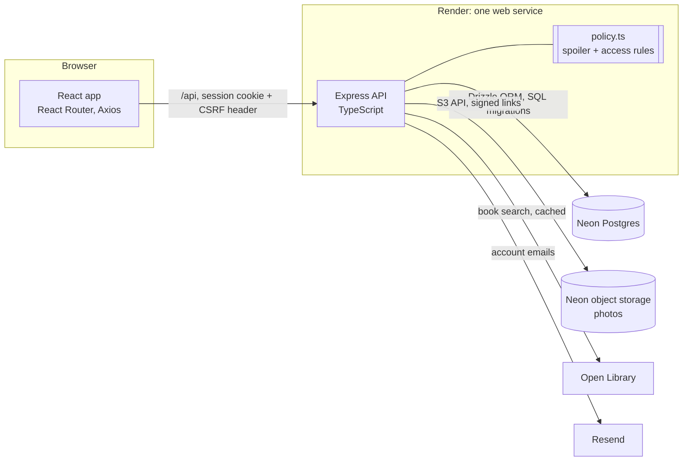

- **One service, one URL.** Express serves both `/api` and the built React app, so there's no CORS and cookies stay first-party.
- **Database first.** Constraints (unique usernames, valid roles, chapter ranges, one open report per reader) live in Postgres, and every migration is a committed SQL file applied on startup.
- **Photos never touch the server disk.** They go to a private bucket and are served through short-lived signed links, so they survive redeploys.
- **Third parties never see who's reading.** Book search is proxied and cached by the server; fonts are self-hosted.

The reasoning behind each choice is in the [decision log](docs/decisions/README.md).

## Security and privacy

| Area | How it's handled |
| --- | --- |
| Sessions | Random token in an `httpOnly`, `Secure`, `SameSite=Lax` cookie; only its SHA-256 hash is stored. Server-side logout; 30-day expiry |
| CSRF | Double-submit token required on every state-changing request |
| Passwords | bcrypt, at least 8 characters; changing or resetting signs out other devices; changing needs the current password |
| Reset and confirmation links | 256-bit random, stored hashed, single use, short-lived (1 h / 48 h), only the newest works, built from `APP_URL` (not the request's Host header) |
| Account discovery | Sign-in and "forgot password" give the same answer whether or not an account exists; sign-in also takes about the same time either way |
| Abuse | Rate limits on sign-in, sign-up, password reset, uploads and posting; reporting, blocking, moderator hiding, admin suspension |
| Authorization | The user always comes from the session, never the request body; access rules live in one module and are tested per route |
| Uploads | Type and size checked; stored under a server-chosen key; only known keys can be served |
| Headers | Helmet with a strict Content-Security-Policy (images only from this site, the photo bucket and Open Library covers) |
| GDPR | Terms and privacy consent with version recorded; minimum age 16; data export and self-service deletion; no tracking cookies; no Google Fonts |

Found a security problem? Please don't open a public issue: email the address in the [Impressum](https://gawainbook.onrender.com/impressum).

## Project structure

```
.
├── Node-Rest-API/            Express API in TypeScript (also serves the built React app)
│   ├── src/
│   │   ├── db/               Drizzle schema (users, follows, posts, post_likes) and connection
│   │   ├── routes/           /api/auth, /api/users, /api/posts
│   │   ├── storage.ts        Neon object storage (or local disk as a fallback)
│   │   ├── app.ts            Express app: security headers, uploads, images, routes
│   │   ├── index.ts          Entry point: env, migrations, server
│   │   └── scripts/          Demo data, admin rights, e2e server, MongoDB → Postgres migration
│   ├── drizzle/              SQL migrations (generated by drizzle-kit, committed)
│   ├── public/images/        Bundled default images (avatars, placeholders)
│   └── tests/                API, database, storage and migration tests
├── react-frontend/           React app (Create React App)
├── e2e/                      Playwright end-to-end tests (circle journey, accounts, moderation)
├── docs/                     Banner, screenshots, decision log, launch plan, book sources
├── neon.ts                   Neon infrastructure as code (Postgres + "assets" bucket)
├── package.json              Root scripts: build, start, test
└── render.yaml               Render deployment blueprint
```

## Getting started

### Prerequisites

- **Node.js 22 (LTS)**, the version Render and CI use (see `.nvmrc`). Node 24 on Windows can crash during the backend test run. The frontend's `react-scripts` 4 only runs on Node 16, so the root scripts run it through `npx -p node@16` automatically.
- **A Neon project** with Postgres and object storage. The [Neon CLI](https://neon.com/docs/cli) sets it up for you.

### 1. Clone and install

```bash
git clone https://github.com/rafeyshah/GawainBook-SocialMediaApp.git
cd GawainBook-SocialMediaApp
npm ci && npm run install:all
```

### 2. Connect to Neon

```bash
npm i -g neon@latest
neon login
neon link            # pick your project and branch
neon deploy          # creates the "assets" bucket from neon.ts
```

`neon deploy` writes the connection variables into `.env.local` in the repo root (it's git-ignored). The backend reads it automatically.

| Variable | Description |
| --- | --- |
| `DATABASE_URL` | Pooled Postgres URL, used by the app |
| `DATABASE_URL_UNPOOLED` | Direct Postgres URL, used for migrations |
| `AWS_ACCESS_KEY_ID`, `AWS_SECRET_ACCESS_KEY`, `AWS_ENDPOINT_URL_S3`, `AWS_REGION` | Neon object storage credentials. Without them, uploads are saved to local disk |
| `PORT` | API port. Defaults to `8800` |
| `LEGAL_NAME`, `LEGAL_ADDRESS`, `LEGAL_EMAIL` | Your details for the Impressum and privacy notice. `LEGAL_ADDRESS` lines are separated by `|` |
| `WAITLIST_OPEN` | Set to `true` to accept waitlist sign-ups. Only takes effect once the three legal details are set |

> Tip: use `neon checkout dev --create` to work on your own copy-on-write branch of the database and files instead of production.

### 3. Run it

```bash
npm run build     # builds the React app and the TypeScript API
npm start         # http://localhost:8800 (runs migrations on startup)
```

Check http://localhost:8800/api/health. It should return something like `{"db":"connected","error":null,"storage":"neon","email":"log","apiVersion":5}`.

`"email":"log"` means no Resend key is set: password-reset and confirmation emails are printed in the API's console instead of being sent, so you can copy the link from there.

For frontend development with live reload, run the API as above, then in a second terminal:

```bash
cd react-frontend
npx -p node@16 node node_modules/react-scripts/bin/react-scripts.js start
```

Open http://localhost:3000. The dev server forwards `/api` requests to the API on port 8800.

### Demo data and admin rights

```bash
cd Node-Rest-API
npm run seed:demo -- --member=<your username>   # sample books, readers and circles (and add you to them)
npm run seed:demo -- --remove                   # delete all demo data again
npm run admin -- --grant=<your username>        # site-wide moderation at /admin
npm run admin -- --list
```

These use the database in `.env.local`, which is your **production** database if that's where it points.

### Changing the database schema

Edit `Node-Rest-API/src/db/schema.ts`, then generate a migration and commit it:

```bash
cd Node-Rest-API
npm run db:generate
```

Migrations are applied automatically, over the direct connection, when the server starts.

## API reference

Every endpoint is under `/api`. Request and response bodies are JSON.

**Authentication:** sign-in sets an httpOnly `gb_session` cookie. Every route except health, sign-up, sign-in, legal and waitlist requires it, and the user is **always taken from the session**, never from the request. Every state-changing request must send the `gb_csrf` cookie's value in an `X-CSRF-Token` header.

| Method | Endpoint | Description |
| --- | --- | --- |
| `GET` | `/health` | Database and storage status |
| `POST` | `/auth/register` | Create an account: `{ username, email, password }` |
| `POST` | `/auth/login` | Sign in: `{ email, password }` (sets the session cookie) |
| `POST` | `/auth/logout` | End the session |
| `GET` | `/auth/me` | The signed-in account (401 if signed out) |
| `POST` | `/auth/forgot-password` | `{ email }`: emails a reset link if the account exists (same answer either way) |
| `POST` | `/auth/reset-password` | `{ token, password }`: sets the new password, signs out everywhere, signs you in |
| `POST` | `/auth/verify-email` | `{ token }`: confirms your email (works signed out) |
| `POST` | `/auth/resend-verification` | Sends a new confirmation link |
| `PUT` | `/account/password` | `{ currentPassword, newPassword }` |
| `GET` | `/account/export` | Everything stored about you, as a JSON download |
| `DELETE` | `/account` | `{ password }`: deletes your account |
| `GET` | `/admin/stats`, `/admin/reports` | Admins: numbers and open reports about posts and profiles |
| `POST` / `DELETE` | `/admin/users/:id/suspend`, `/admin/users/:id/unsuspend`, `/admin/posts/:id`, `/admin/reports/:id/dismiss` | Admins: suspend, unsuspend, delete a post, dismiss a report |
| `GET` | `/users?username=` or `/users?userId=` | Get a user |
| `PUT` | `/users/:id` | Update your profile: `desc`, `city`, `from`, `relationship`, `profilePicture`, `coverPicture`, `favoriteGenres`, `readingLanguage`, `pace` (password: see `/account/password`) |
| `GET` | `/users/friends/:userId` | List the people a user follows |
| `PUT` | `/users/:id/follow` | Follow a user |
| `PUT` | `/users/:id/unfollow` | Unfollow a user |
| `POST` | `/posts` | Create a post: `{ desc, img?, spoiler?, spoilerFor? }` |
| `PUT` | `/posts/:id` | Edit your post: `{ desc?, spoiler?, spoilerFor? }` |
| `DELETE` | `/posts/:id` | Delete your post |
| `PUT` | `/posts/:id/like` | Like or unlike a post → `{ liked, likes }` |
| `GET` | `/posts/:id` | Get a post |
| `GET` | `/posts/timeline` | Your feed: your posts plus posts from people you follow |
| `GET` | `/posts/profile/:username` | A user's posts |
| `GET` / `POST` | `/posts/:id/comments` | Comments on a post (oldest first) / add one `{ body }` |
| `PATCH` / `DELETE` | `/post-comments/:id` | Edit your comment `{ body }` / delete it (yours, or any on your post) |
| `GET` | `/legal` | Public: Impressum details and whether the waitlist is open |
| `POST` | `/waitlist` | Public: `{ email, favouriteGenre, organizesBookClub, consent: true }` |
| `GET` | `/books`, `/books/:idOrSlug` | Books, with your shelf and progress |
| `GET` | `/books/search?q=` | `{ local, openLibrary, openLibraryError }`: our books plus Open Library results |
| `PUT` | `/books/:id/progress` | `{ shelf?, chapter? }`: set your shelf and/or chapter |
| `GET` | `/shelves[?username=]` | Shelves (others' shelves never include chapters) |
| `GET` | `/circles` | `{ mine, discover }` |
| `POST` | `/circles` | Start a circle: `{ name, bookId, visibility, schedule?, description? }` |
| `GET` | `/circles/:id` | A circle (404 if private and you're not a member) |
| `POST` | `/circles/:id/join`, `/circles/join`, `/circles/:id/leave` | Join a public circle, join with `{ code }` (invite link or permanent code), leave |
| `GET` | `/invitations/:code` | What an invite link leads to (410 if expired, used up or turned off) |
| `GET` / `POST` | `/circles/:id/invitations` | Moderators: active links / create `{ expiresInDays?, maxUses? }` |
| `DELETE` | `/circles/:id/invitations/:invId` | Moderators: turn a link off |
| `PUT` / `DELETE` | `/circles/:id/members/:userId` | Owner: set `{ role: "moderator" \| "member" }` / owner or moderator: remove a member |
| `GET` | `/circles/:id/search?q=` | Search discussions up to your chapter |
| `GET` | `/circles/:id/reports` | Moderators: open reports with the reported text |
| `GET` / `POST` | `/circles/:id/threads` | Discussions (later chapters come back locked) / start one `{ chapter, title, body? }` |
| `GET` | `/threads/:id` | A discussion and its replies (403 with no content if locked) |
| `PATCH` / `DELETE` | `/threads/:id` | Edit your discussion `{ title?, body? }` / delete it (moderators: any) |
| `POST` | `/threads/:id/comments` | Reply `{ body }` |
| `PATCH` / `DELETE` | `/comments/:id` | Edit your reply `{ body }` / delete it (moderators: any reply) |
| `POST` | `/threads/:id/hide`, `/threads/:id/unhide`, `/comments/:id/hide`, `/comments/:id/unhide` | Moderators: hide or show content |
| `POST` | `/reports` | Report `{ targetType: "thread" \| "comment" \| "post" \| "user", targetId, reason, details? }` (posts and profiles go to admins) |
| `POST` | `/reports/:id/dismiss` | Moderators: dismiss a report |
| `GET` / `PUT` / `DELETE` | `/blocks`, `/blocks/:userId` | Your blocked readers / block / unblock |
| `GET` | `/notifications` | `{ unread, items }`, filtered by the spoiler rule when read |
| `POST` | `/notifications/read` | Mark `{ ids }` (or everything) as read |
| `POST` | `/upload` | Upload an image (multipart field `file`; PNG, JPG, GIF or WebP, max 5 MB) → `{ filename }` |

Uploaded images are served at `/images/<filename>`, which redirects to a signed, time-limited link in the private bucket.

## Testing

Both halves of the app have automated tests. They cover success paths, validation, missing and invalid data, permissions, concurrency, database constraints, failure handling and the security fixes.

```bash
npm test                  # everything
npm run test:backend      # API + database tests
npm run test:frontend     # React tests
npm run test:e2e          # Playwright: the whole circle journey in a real browser
```

- **Backend:** Jest and Supertest against a **real, throwaway PostgreSQL server** (embedded-postgres), with the real migrations applied, so constraints and cascades are tested exactly as they run in production. Object storage is tested with a fake S3 client. Nothing touches Neon.
- **Frontend:** Jest and React Testing Library, with real-browser checks of key flows against the live site.
- **End to end:** [Playwright](e2e/tests/circle-journey.spec.js) drives two readers through the core promise: sign up, join with an invite link, set chapter 4, see chapters 1–4, find chapter 9 locked (in the list, by direct link, through the API and in search), reply, and get notified. It runs against a throwaway server with its own temporary database (`npm run build` in both apps first). `npm run test:e2e:live` runs it against the live site and deletes its test accounts afterwards.

Current totals: **653 backend tests**, **468 frontend tests** and **4 end-to-end tests** (the circle journey; accounts and email; reporting and admin; posts, spoilers and comments), all passing.

## Deployment

The app deploys to [Render](https://render.com) using [`render.yaml`](render.yaml). Every push to `master` rebuilds the React app and the API and redeploys them together; migrations run when the new server starts.

**One-time setup**
1. In Render, choose **New → Blueprint** and select this repository.
2. When prompted, paste the values from your `.env.local`: `DATABASE_URL`, `DATABASE_URL_UNPOOLED`, `AWS_ACCESS_KEY_ID`, `AWS_SECRET_ACCESS_KEY` and `AWS_ENDPOINT_URL_S3`.
   For account emails also set `RESEND_API_KEY` and `MAIL_FROM` (a sender on a domain verified in [Resend](https://resend.com)); without them, emails only go to the server log. See [launch readiness](docs/launch-readiness.md) for everything to do before opening up.
3. After the deploy, open `/api/health` and check for `"db":"connected"` and `"storage":"neon"`.

**Demo data (optional)**

```bash
cd Node-Rest-API
npm run seed:demo -- --member=<your-username>   # sample readers, circles and discussions
npm run seed:demo -- --remove                   # delete all of it
```

Sample accounts are clearly labelled ("Sample reader · demo account") and use the reserved `sample.gawainbook.invalid` email domain. The command prints their password. It's safe to run more than once, and `--remove` keeps real accounts.

**Moving data from the old MongoDB database (once)**

```bash
# add MONGO_URL to Node-Rest-API/.env, then:
cd Node-Rest-API
npm run migrate:mongo -- --dry-run   # shows what would move
npm run migrate:mongo                # copies users, follows, posts, likes and images
```

It keeps user ids and password hashes, so existing accounts keep working, and it's safe to run more than once.

**Known limitations on the free plan**
- The web service sleeps when idle, so the first request afterwards is slow.
- Neon's free compute suspends when idle; the first query after that takes a little longer.

## Product discovery

Interview script, recruiting posts and notes template: [`docs/discovery/`](docs/discovery/README.md).

## Contributing

Contributions are welcome.

1. Fork the repo and create a branch: `git checkout -b feature/my-change`
2. Commit your changes with a clear message.
3. Open a pull request describing what changed and why.

For larger changes, please open an issue first to discuss the approach.

## License

Released under the [MIT License](https://choosealicense.com/licenses/mit/).
